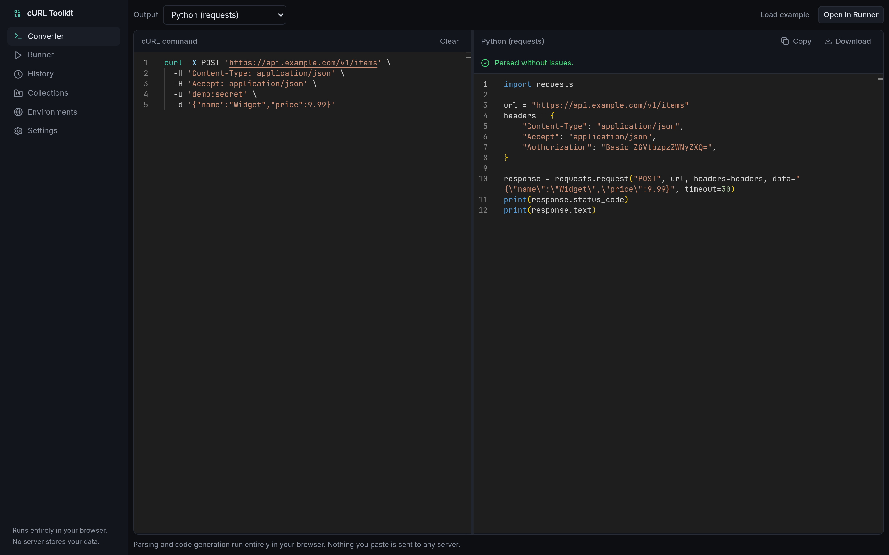

# cURL Toolkit

**[Open the app →](https://nullstacks.github.io/curl-toolkit/)**

Paste a cURL command, get working code in 18 languages or request formats — Python `requests` by default. Then edit the request, send it, and keep it as a saved request, all in the browser. There is no backend, no account, and nothing you paste leaves the page.



## What it does

**Convert.** Paste a cURL command and the left pane parses it into a structured request: method, URL, query params, headers, cookies, auth, and body (raw JSON, form-urlencoded, multipart, binary). Pick any output language and the right pane regenerates as you type. Anything the parser cannot map is surfaced as a warning with a reason — options are never silently dropped.

**Run.** The same parsed request opens in the Runner with editable tabs for Params, Headers, Cookies, Auth, Body and per-request Settings. Send it with `fetch`, read the status, timing, size, headers and pretty-printed body.

**Keep.** Saved requests go into collections with folders, favourites and search. Every send lands in history. Environments hold `{{variables}}` with secret flags. Everything is stored in IndexedDB and can be exported to a JSON backup.

The layout is responsive: side-by-side editors and a resizable splitter on desktop, a stacked single-column flow with a vertical splitter below 768px.

## Output formats

Shell: cURL, Wget, HTTPie, PowerShell

Scripting: **Python (requests) — default**, JavaScript (fetch), Node.js (fetch), Ruby (Net::HTTP), PHP (cURL)

Compiled: Go, Java (HttpClient), C# (HttpClient), Rust (reqwest)

Mobile: Swift (URLSession), Kotlin (java.net), Dart (http)

Data: raw HTTP, HAR (HTTP Archive)

All generators render from one language-neutral IR (`src/lib/codegen/ir.ts`), so a fix to request semantics lands in every language at once. The cURL round trip (parse → IR → generate → parse) is covered by tests.

## Security notes

- Passwords, bearer tokens, API key values, cookies and secret-looking headers are **masked before anything is written to IndexedDB**. Settings can drop them entirely instead of masking.
- Requests whose secrets were masked are flagged in the UI, so you know to re-enter them before sending.
- There is no server and no telemetry. The only third-party request the page makes is the Google Fonts stylesheet for Inter and JetBrains Mono (which reveals your IP to Google, like any font CDN); self-host the two fonts if you want zero external requests.
- Local data is **not encrypted**: anything in this browser profile can read it. Do not keep production credentials on a shared machine.
- Environment variables marked secret are stored in clear text — the flag only hides the value in the UI.

## Known limits (browser sandbox)

These are browser restrictions, not missing features. The app flags them rather than pretending to send them:

- `Host`, `Cookie`, `Origin`, `User-Agent`, `Content-Length`, `Referer` and similar headers cannot be set by script. They are shown and flagged, not sent.
- Only `http:` and `https:` are supported.
- No client certificates, proxies, custom CA bundles, `--insecure`, DNS overrides, or local file uploads.
- CORS is real and cannot be bypassed. Requests to servers without permissive CORS headers fail in the browser; those are classified as network errors with an explanation. Response headers are readable only when the server sends `Access-Control-Expose-Headers`.
- gRPC, HTTP/2-only endpoints and WebSocket upgrades are out of scope.

## What runs where

- `src/lib/curl/parser.ts` tokenises a shell command and maps options to an editable request. Unsupported options are returned as data with a reason, never silently dropped.
- `src/lib/codegen/` builds one language-neutral intermediate representation (`ir.ts`) and renders it per language.
- `src/lib/http/prepare.ts` builds the exact method, URL, headers and body that will be sent.
- `src/lib/http/runner.ts` sends the request with `fetch`, using `AbortController` for timeouts and cancellation. It classifies failures as cancelled, timeout, network or invalid.
- `src/lib/storage/` holds the Dexie (IndexedDB) schema, secret redaction, and backup import/export.

## Run locally

```bash
npm install
npm run dev        # Vite dev server
npm test           # Vitest: parser, codegen, persistence, fetch runner
npm run build      # type-check, then static build into dist/
npm run preview    # serve dist/
```

## Deploy

The build uses relative asset paths (`base: './'`), so `dist/` works from a subdirectory with no rewrite rules. Drop it on GitHub Pages, Cloudflare Pages, Netlify, Vercel or any static host.

This repo deploys through `.github/workflows/deploy.yml`: every push to `main` runs the tests, builds, and publishes `dist/` to the `gh-pages` branch, which GitHub Pages serves.

## Stack

React 18, TypeScript, Vite, Tailwind, Zustand for app state, Dexie (IndexedDB) for storage, Monaco for the editors, Lucide for icons. 34 tests across the parser, generators, persistence layer and request runner.

## License

MIT
